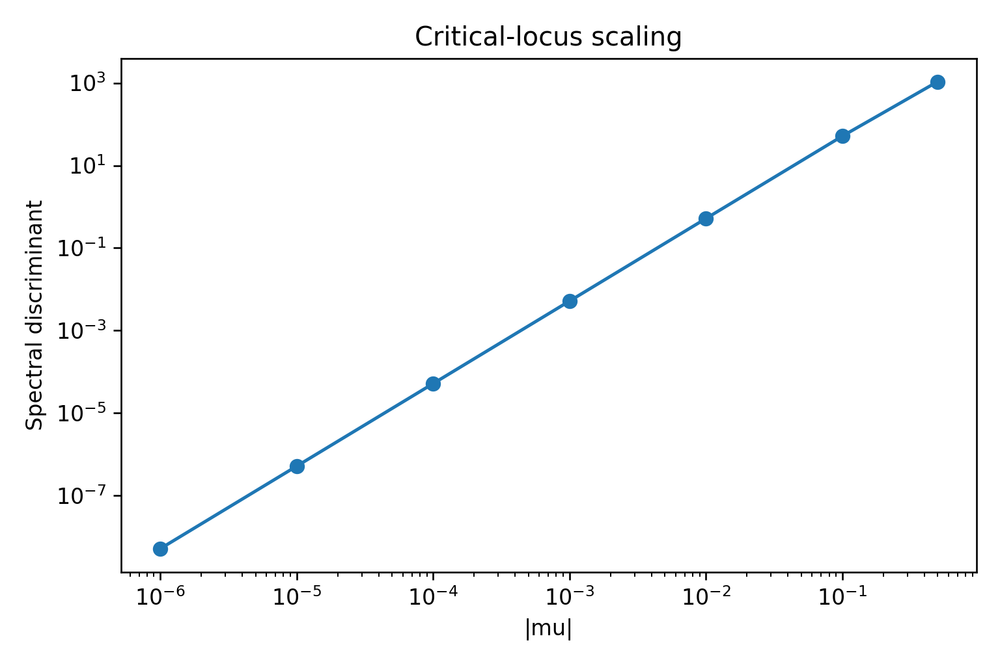
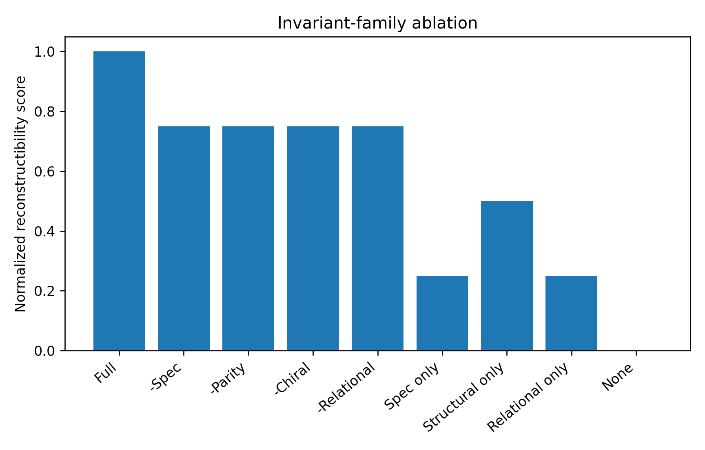

**Companion to:** *Invariant Reduction and Falsification of a Warped Five-Dimensional Orbital Field Model*.  
**Status:** Submission-preparation supplementary material; not peer reviewed.

# S1. Scope and evidence boundary

This supplement documents the complete mathematical and computational protocol used to reduce and stress-test the supplied Five-Dimensional Orbital Field Theory (OFT). Synthetic experiments establish properties of the proposed invariant representation under controlled transformations. They do not establish that OFT is physically realized. The continuum-equivalent final test validates a specific odd/Dirichlet warped spectral branch against an independent numerical discretization; it is not a proof of the full coupled 5D Standard Model sector.

All random experiments use the frozen seed

$$
\boxed{20260812}.
$$

# S2. Source-to-reduced-theory map

## S2.1 Objects retained from the source model

The strict five-dimensional core contains

$$
\mathcal M_5=M_{3,1}\times S^1/\mathbb Z_2,
$$

$$
ds^2=e^{-2k|w|}\eta_{\mu\nu}dx^\mu dx^\nu-dw^2,
$$

and a KK expansion

$$
\Psi_f(x,w)=\sum_n\psi_{n,f}(x)f_{n,f}(w).
$$

The source $I\times S^2$ extension is not included in the strict-5D core because it adds two extra coordinates and yields a seven-dimensional product space. Angular data are therefore assigned to four-dimensional rotational symmetry unless a separate higher-dimensional extension is explicitly defined.

## S2.2 Object classification

| Source object | Revised classification | Rationale |
|---|---|---|
| $k,L,M$ | dimensional parameters | change numerically under unit conventions |
| $kL$, $M/k$ | dimensionless moduli | survive unit quotient |
| $n$ | mode label | changes under relabeling; not intrinsic |
| $\lambda_n$ / unordered spectrum | spectral invariant | preserved under similarity |
| $l(l+1)$ | rotational Casimir data | invariant within $SO(3)$ representation |
| $m$ | basis/axis label | not invariant under arbitrary rotations |
| $f_n(w)$ | coordinate/basis-dependent profile | representation dependent |
| $F^\dagger WF$ | metric-aware relational invariant | preserved under simultaneous coordinate/metric transform |
| $C_q$ | covariant operator | transforms by conjugation |
| $\operatorname{tr}(C_{i_1}\cdots C_{i_r})$ | joint relational invariant | simultaneous-conjugation invariant |
| diagonal Higgs overlap in degenerate sector | basis dependent | changes under degenerate-subspace rotation |
| $P_\lambda H P_\lambda$ spectrum | projected Higgs invariant | conjugacy invariant |
| $\pi$, boundary sector | discrete structural invariant | changes only across structural sector |
| $\nu_\chi$ | chiral/index candidate | structural under appropriate operator assumptions |
| $\Delta_O=0$ | critical locus | marks spectral collision and stabilizer change |
| physical mass/coupling | derived observable | function of invariant and model data |

# S3. Algebraic-geometric organization

For a finite $N$-mode truncation, let $\mathcal X_N$ denote the algebraic configuration space after discretization or projection of the continuum constraints. A group $G_N$ acts by basis, field, gauge, and normalization transformations. The finite quotient is represented formally by

$$
\mathfrak M_N=\mathcal X_N//G_N
$$

and

$$
\mathbb C[\mathfrak M_N]=\mathbb C[\mathcal X_N]^{G_N}.
$$

For a single operator under conjugation, the characteristic coefficients generate the symmetric spectral information:

$$
P_O(t)=\det(tI-O)=t^N-s_1t^{N-1}+\cdots+(-1)^Ns_N.
$$

If the eigenvalues are $\lambda_1,\ldots,\lambda_N$, then

$$
\mathbb C[\lambda_1,\ldots,\lambda_N]^{S_N}
=\mathbb C[s_1,\ldots,s_N].
$$

For multiple matrices under simultaneous conjugation, traces of matrix words supply natural invariant coordinates. In the experiments we use low-order mixed traces to demonstrate information absent from individual spectra.

# S4. Experiment registry

The final package contains fourteen tests. Experiments E1-E10 stress the invariant formalism; E11-E14 are source-specific numerical/phenomenological tests.

| ID | Test | Main question |
|---|---|---|
| E1 | spectral conjugation | does spectrum survive representation change? |
| E2 | non-isospectral perturbation | does spectrum respond to genuine operator change? |
| E3 | weighted Gram | is relational geometry metric-aware? |
| E4 | overlap covariance | are interaction entries invariant or only covariant? |
| E5 | degenerate Higgs block | what survives basis rotation inside a degenerate eigenspace? |
| E6 | normalization quotient | is overall equation scale removable? |
| E7 | unit quotient | do $kL$ and $M/k$ survive unit rescaling? |
| E8 | critical locus | does the discriminant detect degeneracy/symmetry enhancement? |
| E9 | joint relational invariant | can equal individual spectra hide different relationships? |
| E10 | reconstructibility ablation | which invariant families carry law identity? |
| E11 | warped finite-difference validation | does an independent discretization recover exact finite-warp roots? |
| E12 | large-warp approximation | where is $x_n\simeq j_{\nu,n}$ accurate? |
| E13 | source Table A.1 audit | are the stated Bessel roots numerically correct? |
| E14 | generation-spacing stress test | can pure KK spacing reproduce charged-lepton mass ratios? |

# S5. E1 - Spectral conjugation

## Hypothesis

For a symmetric positive operator

$$
O=A^TA+0.25I
$$

and random orthogonal $U$,

$$
O'=UOU^T,
$$

we expect

$$
\operatorname{Spec}(O')=\operatorname{Spec}(O).
$$

## Protocol

One thousand independent $8\times8$ operators were generated. We measured relative eigenvalue error, relative change of raw matrix coordinates, and error of the power-trace vector

$$
(\operatorname{tr}O,\ldots,\operatorname{tr}O^8).
$$

## Result

Median eigenvalue error:

$$
4.952626\times10^{-16}.
$$

Median power-trace error:

$$
1.076582\times10^{-15}.
$$

Median raw matrix change:

$$
0.989426.
$$

The orbit moves almost one matrix norm while the spectral class remains unchanged.

# S6. E2 - Non-isospectral perturbation control

A fixed base operator was transformed and then perturbed:

$$
O'=UOU^T+\varepsilon H,
$$

where $H$ was symmetric and Frobenius-normalized to $O$. The perturbation grid was

$$
\varepsilon\in\{10^{-8},10^{-6},10^{-4},10^{-2},10^{-1}\}.
$$

The log-log slope of median spectral deviation versus $\varepsilon$ was

$$
\boxed{0.999089},
$$

showing approximately linear spectral sensitivity to genuine operator perturbation.

# S7. E3 - Weighted Gram invariance

Let

$$
G=F^TWF.
$$

Under invertible coordinate map $A$,

$$
F'=A^{-1}F,
\qquad
W'=A^TWA.
$$

Then

$$
F'^TW'F'=F^TWF.
$$

Five hundred random tests gave median relative error

$$
5.954819\times10^{-16}.
$$

The negative control held $W$ fixed and produced median error

$$
0.888421.
$$

Thus the metric/measure is part of the relational identity.

# S8. E4 - Overlap covariance

For symmetric overlap operator $C$ and basis rotation $U$,

$$
C'=U^TCU.
$$

Across 1000 trials, raw entries changed by median relative amount

$$
1.383717,
$$

whereas the eigenvalue spectrum changed by only

$$
5.314030\times10^{-16}.
$$

Therefore entries are not fundamental invariants.

# S9. E5 - Degenerate Higgs block

Within a three-dimensional degenerate eigenspace, a projected Higgs operator $H_\lambda$ was rotated by random orthogonal transformations. The diagonal vector changed by median relative amount

$$
1.068824,
$$

while the projected spectrum changed by

$$
3.519431\times10^{-16}.
$$

The correct object is therefore the conjugacy class of

$$
P_\lambda H P_\lambda,
$$

not its basis-dependent diagonal entries.

# S10. E6 - Overall normalization quotient

For a law written

$$
aOf-b\lambda f=0,
$$

multiplication by $s\ne0$ gives

$$
(sa)Of-(sb)\lambda f=0
$$

with the same zero locus. In 2000 trials the raw coefficient vector changed by median relative amount 2.379990, whereas the ratio $b/a$ had zero median error and the projective coordinate $[a:b]$ had median error $1.11\times10^{-16}$.

This is an explicit example of an $I_0$ removable coefficient.

# S11. E7 - Unit quotient

The numerical unit transformation was modeled as

$$
k' = uk,\qquad L'=L/u,\qquad M'=uM.
$$

Across 5000 trials with $u$ spanning $10^{-9}$ to $10^9$,

$$
k'L'=kL
$$

and

$$
\frac{M'}{k'}=\frac{M}{k}
$$

were preserved to machine precision. The median raw displacement in $(\log_{10}k,\log_{10}L,\log_{10}M)$ was 7.6847. Hence $(k,L,M)$ is not the appropriate quotient coordinate, while $(kL,M/k)$ is.

# S12. E8 - Spectral discriminant and critical locus

For

$$
\Lambda(\mu)=\operatorname{diag}(1+\mu,1-\mu,3,4),
$$

define

$$
\Delta(\mu)=\prod_{i<j}(\lambda_i-\lambda_j)^2.
$$

Near $\mu=0$ the fitted scaling exponent was

$$
\boxed{1.999994},
$$

consistent with the explicit squared eigenvalue splitting. At $\mu=0$, the first two eigenvalues are degenerate and the continuous orthogonal stabilizer acquires an $O(2)$ factor. Thus the discriminant-zero locus simultaneously signals multiplicity change and symmetry enhancement.

{width=75%}

# S13. E9 - Joint relational invariants

Let

$$
C_1=\operatorname{diag}(1,2,4,7),
$$

$$
C_2^{(A)}=\operatorname{diag}(3,5,8,11),
$$

and

$$
C_2^{(B)}=\operatorname{diag}(5,3,8,11).
$$

The two $C_2$ matrices have identical individual spectra, yet

$$
\operatorname{tr}(C_1C_2^{(A)})=122,
$$

and

$$
\operatorname{tr}(C_1C_2^{(B)})=120.
$$

Across 2000 simultaneous conjugations, the mixed trace was preserved with median relative error

$$
2.329648\times10^{-16}.
$$

This proves by counterexample that a set of separate operator spectra can fail to encode relative alignment. Joint invariants are required.

# S14. E10 - Reconstructibility ablation

A synthetic class was represented by four independent binary invariant families:

$$
C=(S,P,\chi,R)\in\{0,1\}^4.
$$

There are 16 equiprobable identity classes and

$$
H(C)=4\ \text{bits}.
$$

For a retained invariant subset $I$,

$$
R(I)=1-\frac{H(C|I)}{4}.
$$

| Retained set | conditional entropy | reconstructibility | max exact identity accuracy |
|---|---:|---:|---:|
| full | 0 bits | 1.00 | 1.0000 |
| any three families | 1 bit | 0.75 | 0.5000 |
| structural only $(P,\chi)$ | 2 bits | 0.50 | 0.2500 |
| spectrum only | 3 bits | 0.25 | 0.1250 |
| relational only | 3 bits | 0.25 | 0.1250 |
| none | 4 bits | 0.00 | 0.0625 |

The test is intentionally constructed to make the families independent; it therefore demonstrates necessity under the synthetic design, not an empirical estimate of their independence in nature.

{width=82%}

# S15. E11 - Exact finite-warp determinant and independent finite-difference solver

## S15.1 Dimensionless transformation

Starting from the warped profile equation in the audited Bessel branch, define

$$
s=kw,
\qquad
\kappa=kL,
\qquad
x=\frac{m}{ke^{-\kappa}}.
$$

The dimensionless differential problem is

$$
\left[-\frac{d^2}{ds^2}+\nu^2\right]f
=x^2e^{2(s-\kappa)}f.
$$

For the odd orbifold branch,

$$
f(0)=f(\kappa)=0.
$$

Setting

$$
z=xe^{s-\kappa}
$$

gives

$$
\frac{d}{ds}=z\frac{d}{dz}
$$

and

$$
\frac{d^2}{ds^2}=z^2\frac{d^2}{dz^2}+z\frac{d}{dz}.
$$

Substitution yields

$$
z^2f_{zz}+zf_z+(z^2-\nu^2)f=0,
$$

with general solution

$$
f(z)=aJ_\nu(z)+bY_\nu(z).
$$

## S15.2 Finite-warp determinant

Applying Dirichlet conditions at

$$
z_{\mathrm{UV}}=xe^{-\kappa},
\qquad
z_{\mathrm{IR}}=x
$$

requires the coefficient determinant to vanish:

$$
\boxed{
D_\nu(x;\kappa)=
J_\nu(xe^{-\kappa})Y_\nu(x)
-Y_\nu(xe^{-\kappa})J_\nu(x)=0.
}
$$

In the large-warp limit, for the regular parameter regimes tested here, this tends to the usual $J_\nu(x)=0$ approximation.

## S15.3 Finite-difference generalized eigenproblem

Choose $N$ equally spaced interior points

$$
s_i=ih,
\qquad
h=\frac{\kappa}{N+1}.
$$

The centered second derivative gives

$$
-f''(s_i)
\approx
\frac{-f_{i-1}+2f_i-f_{i+1}}{h^2}.
$$

Thus

$$
Af=x^2Bf,
$$

where

$$
A=\operatorname{tridiag}
\left(-h^{-2},2h^{-2}+\nu^2,-h^{-2}\right)
$$

and

$$
B_{ii}=e^{2(s_i-\kappa)}.
$$

The sparse generalized eigenproblem was solved with shift-invert methods for the lowest six modes.

## S15.4 Convergence table

For $c=0.4$, $\nu=0.9$, $\kappa=35$:

| $N$ | max relative error (modes 1-6) | median relative error |
|---:|---:|---:|
| 200 | $9.2967\times10^{-2}$ | $5.5189\times10^{-2}$ |
| 400 | $4.2412\times10^{-2}$ | $1.4255\times10^{-2}$ |
| 800 | $1.0083\times10^{-2}$ | $3.5204\times10^{-3}$ |
| 1600 | $2.4914\times10^{-3}$ | $8.7779\times10^{-4}$ |
| 3200 | $6.2127\times10^{-4}$ | $2.1937\times10^{-4}$ |
| 6400 | $1.5524\times10^{-4}$ | $5.4847\times10^{-5}$ |

The fitted convergence order for $N\ge400$ is

$$
\boxed{2.020808}.
$$

The first six exact roots are

$$
3.696347888,
6.871126811,
10.025290199,
13.173489100,
16.319152989,
19.463505660.
$$

This convergence constitutes an independent numerical reconstruction of the finite-warp determinant spectrum.

# S16. E12 - Large-warp approximation sweep

For each tested pair $(c,\kappa)$, exact roots of $D_\nu(x;\kappa)=0$ were compared with zeros of $J_\nu$, where $\nu=c+1/2$.

Selected maximum relative errors over modes 1-4 are:

| $c$ | $\nu$ | $kL$ | max relative error |
|---:|---:|---:|---:|
| -0.4 | 0.1 | 3 | 0.201908 |
| -0.4 | 0.1 | 5 | 0.089042 |
| -0.4 | 0.1 | 10 | 0.022499 |
| -0.4 | 0.1 | 20 | 0.002627 |
| -0.4 | 0.1 | 35 | 0.000128 |
| 0.4 | 0.9 | 3 | 0.025276 |
| 0.4 | 0.9 | 5 | 0.000841 |
| 0.4 | 0.9 | 7 | $2.331\times10^{-5}$ |
| 0.4 | 0.9 | 10 | $1.053\times10^{-7}$ |
| 0.4 | 0.9 | 20 | $1.62\times10^{-15}$ |

The large-warp approximation is excellent in the representative $c=0.4$ regime but should not be assumed uniformly accurate, especially as $\nu$ approaches zero and $\kappa$ is moderate.

# S17. E13 - Source Table A.1 numerical audit

The source claims $c=0.4$ and $\nu=0.9$ but lists roots

$$
(3.52,6.71,9.88).
$$

High-precision values are

$$
J_{0.9}:\quad
(3.696347888,6.871126811,10.025290199).
$$

For comparison,

$$
J_{0.8}:\quad
(3.559780402,6.725715332,9.876364989).
$$

The third listed source value is within 0.037% of the $J_{0.8}$ third root but 1.45% from the $J_{0.9}$ third root. Across all three modes, the source is consistently closer to $J_{0.8}$, but the experiment does not infer the cause. The corrected strict-5D appendix should calculate roots directly from the stated $\nu$ rather than reuse the old table.

# S18. E14 - Charged-lepton generation-spacing stress test

For large warp, the pure spectral hypothesis predicts masses proportional to

$$
m_n\propto j_{\nu,n}
$$

if no additional flavor-dependent factors are used. Therefore the scale cancels:

$$
\frac{m_2}{m_1}=\frac{j_{\nu,2}}{j_{\nu,1}},
\qquad
\frac{m_3}{m_1}=\frac{j_{\nu,3}}{j_{\nu,1}}.
$$

Scanning 500 values over

$$
-0.49\le c\le2
$$

produced

$$
\max\frac{x_2}{x_1}=2.287262,
$$

and

$$
\max\frac{x_3}{x_1}=3.582048.
$$

The 2026 PDG charged-lepton values used in the frozen code are

$$
m_e=0.51099895069\ \mathrm{MeV},
$$

$$
m_\mu=105.6583755\ \mathrm{MeV},
$$

$$
m_\tau=1776.93\ \mathrm{MeV},
$$

which imply

$$
\frac{m_\mu}{m_e}=206.768283,
$$

$$
\frac{m_\tau}{m_e}=3477.365262.
$$

Hence no $c$ in the scanned branch makes successive Bessel roots approximate the observed hierarchy. The test falsifies **pure mode spacing as the hierarchy mechanism**; it does not falsify a model in which flavor-dependent Higgs/localization overlaps dominate the mass matrix.

# S19. Revised invariant hierarchy

## S19.1 $I_0$ - removable representation data

$$
\{
\text{overall normalization},
\text{basis},
\text{phase},
\text{raw mode label},
\text{coordinate components}
\}.
$$

## S19.2 $I_1$ - continuous quotient moduli

$$
\Pi_{\mathrm{OFT}}
=\left(kL,\frac{M}{k},g_{\mathrm{dimless}},\lambda_{\mathrm{dimless}},\ldots\right).
$$

## S19.3 $I_2$ - discrete/structural data

$$
\mathcal T_{\mathrm{OFT}}
=([S^1/\mathbb Z_2],\pi,\nu_\chi,[\rho],\operatorname{mult}\operatorname{Spec}).
$$

## S19.4 $I_3$ - critical/discriminant data

$$
\mathcal C_{\mathrm{OFT}}
=\{\Delta_O=0,\det O=0,\text{rank-jump loci},\text{symmetry-enhancement loci}\}.
$$

## S19.5 Spectral and relational data

$$
\mathcal S_{\mathrm{OFT}}=P_O(t)
$$

and

$$
\mathcal R_{\mathrm{OFT}}
=\left
\{
G,
\operatorname{tr}(C_{i_1}\cdots C_{i_r}),
P_{P_\lambda HP_\lambda}(t)
\right\}.
$$

# S20. Minimal falsifiable formulation

A representation-preserving transformation $T$ must satisfy

$$
\boxed{
\mathfrak P_{\mathrm{OFT}}(TX)=\mathfrak P_{\mathrm{OFT}}(X).
}
$$

The current experiments support this as a necessary condition within the tested finite-dimensional and odd-profile sectors. They do not prove that equality of the fingerprint is sufficient for equivalence in the full continuum theory.

The physically strongest unresolved propositions are now explicit:

1. a common higher-dimensional parent-field class can generate several observed fermionic states;
2. a quantitatively specified relational/localization sector can reproduce measured masses and mixings;
3. a structural invariant or dynamical selection rule can produce exactly three light generations;
4. the resulting higher KK tower remains compatible with experimental constraints.

These propositions are falsifiable and should replace the broader original claims.

# S21. Software architecture and reproducibility

The package is organized as follows:

```text
OFT_FINAL_PACKAGE/
  README.md
  requirements.txt
  manuscript.md
  supplementary_appendix.md
  src/
    oft_invariants.py
    run_all_experiments.py
  results/
    all_experiments_summary.csv
    round1_spectral_perturbation.csv
    round2_discriminant.csv
    round2_reconstructibility_ablation.csv
    final_fd_convergence.csv
    final_bessel_approximation_sweep.csv
    final_source_table_A1_audit.csv
    final_generation_spacing_scan.csv
    run_manifest.json
  figures/
    fig1_fd_convergence.png
    fig2_bessel_approximation.png
    fig3_source_table_audit.png
    fig4_generation_spacing.png
    fig5_discriminant.png
    fig6_reconstructibility.png
```

Run from the package root:

```bash
python -m pip install -r requirements.txt
python src/run_all_experiments.py
```

The manifest stores SHA-256 hashes of all result CSVs and figures generated by the frozen run. Re-running the script intentionally overwrites generated results and then regenerates the manifest.

# S22. Statistical and numerical reporting conventions

Synthetic invariance tests report median relative errors because exact transformation identities can produce heavy-tailed floating-point ratios when a reference norm is unusually small. The final continuum test reports both maximum and median relative mode error. Convergence order was estimated from a linear fit of

$$
\log E_N
$$

against

$$
\log N
$$

for $N\ge400$, with sign reversed so positive $p$ denotes

$$
E_N\propto N^{-p}.
$$

The generation-spacing scan is deterministic conditional on the $c$ grid and Bessel solver; no inferential $p$-value is appropriate. Its conclusion is based on direct scale-separated incompatibility within the scanned model class.

# S23. Interpretation guardrails

The following statements are supported by the present package:

- spectral conjugacy invariants survive basis change;
- the weighted Gram structure requires covariant transformation of its metric/weight;
- overlap operators and degenerate Higgs blocks are generally covariant rather than entrywise invariant;
- $kL$ and $M/k$ survive the modeled unit quotient;
- discriminant-zero loci detect controlled spectral degeneracy;
- the exact finite-warp odd-profile spectrum is independently recovered by finite differences;
- the source Bessel table is numerically inconsistent with its stated $J_{0.9}$ order;
- pure successive KK root spacing does not reproduce the charged-lepton hierarchy over the scanned branch.

The following statements are **not** established:

- OFT is a correct theory of Standard Model flavor;
- the electron, muon, and tau are physically the first three KK modes;
- exactly three observed generations follow from the current invariants;
- higher modes are dark matter;
- the full theory satisfies collider, electroweak, flavor, or cosmological constraints;
- the finite invariant fingerprint is complete for the continuum theory.

# S24. References

1. Randall L, Sundrum R. A Large Mass Hierarchy from a Small Extra Dimension. *Physical Review Letters*. 1999;83:3370-3373. doi:10.1103/PhysRevLett.83.3370.
2. Gherghetta T, Pomarol A. Bulk Fields and Supersymmetry in a Slice of AdS. *Nuclear Physics B*. 2000;586:141-162. doi:10.1016/S0550-3213(00)00392-8.
3. Grossman Y, Neubert M. Neutrino Masses and Mixings in Non-Factorizable Geometry. *Physics Letters B*. 2000;474:361-371.
4. Procesi C. The Invariant Theory of $n\times n$ Matrices. *Advances in Mathematics*. 1976;19:306-381.
5. Mumford D, Fogarty J, Kirwan F. *Geometric Invariant Theory*. 3rd ed. Springer; 1994.
6. Takahashi F, et al. (Particle Data Group). Review of Particle Physics. *International Journal of Modern Physics A*. 2026;41:2630011.
